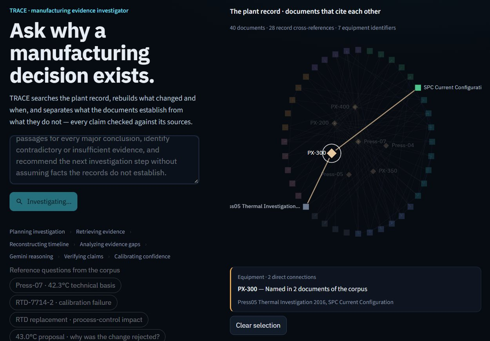
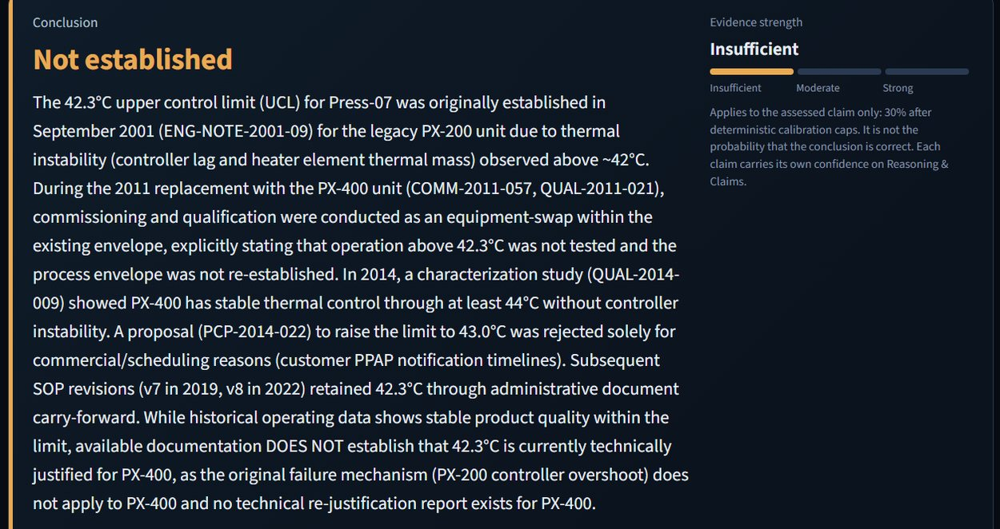
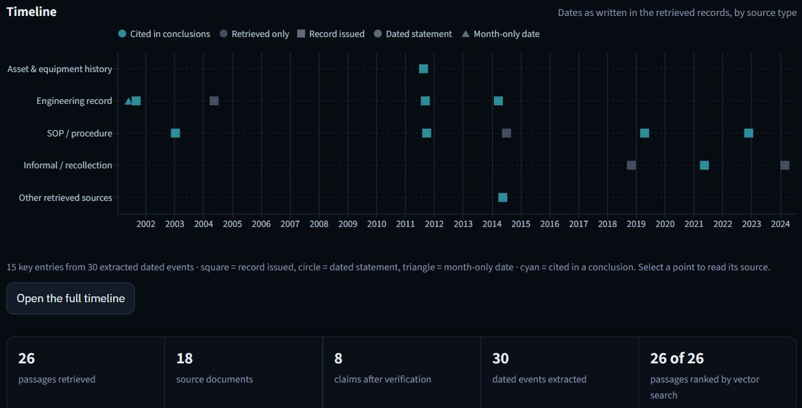
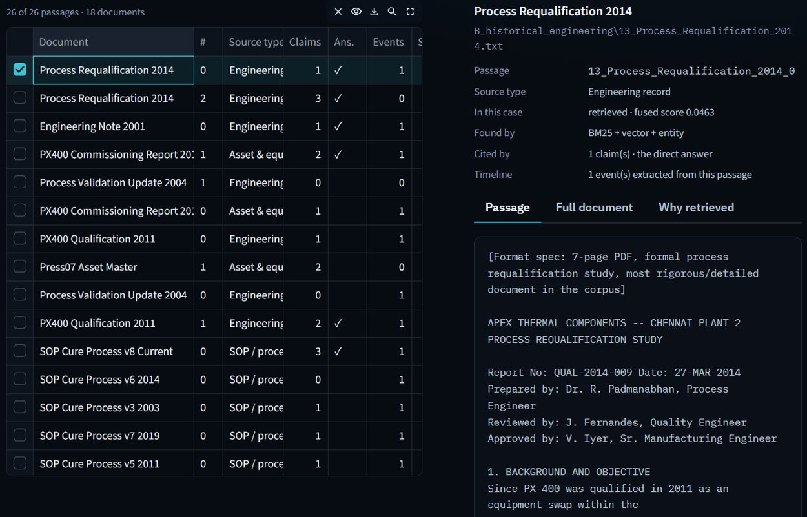
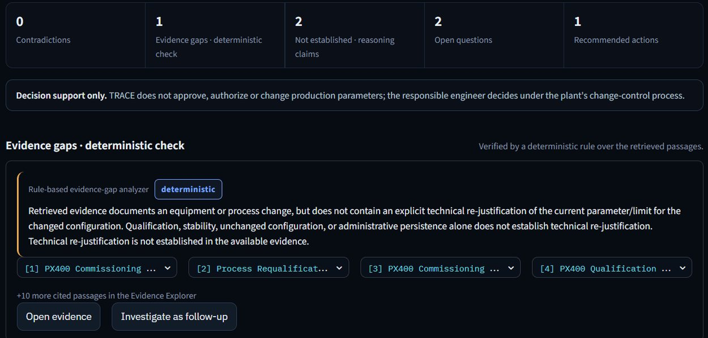

# TRACE — Manufacturing Evidence Investigator

**Ask why a manufacturing decision exists.** TRACE reconstructs the evidence
trail behind a process limit, checks the model's citations with deterministic
code, and reports **NOT ESTABLISHED** when the records do not support an
answer, instead of guessing.

**Live app:** https://trace-investigator-820547504407.asia-south1.run.app (Google Cloud Run)  
**Demo video (2:51):** https://youtu.be/DHLaIBYAxuU  
**Built for:** Google Cloud × H2S AI Builder Cup 2026

> **About the data.** Every document in `data/apex-corpus/` is **synthetic**,
> written for this project about a fictional plant (Apex Thermal Components).
> No real company, plant or production record is included. TRACE is a working
> prototype demonstrated on this curated case; its behaviour on real plant
> records has not been validated yet. See [About the corpus](#about-the-corpus).



| Verdict | Reconstructed timeline |
|---|---|
|  |  |
| **Cited source passage** | **Deterministic evidence-gap check** |
|  |  |

*Screenshots from a live run with Gemini on the Press-07 question. Confidence
figures vary between runs; deterministic caps are ceilings, not fixed outputs.*

**Google services used:** Cloud Run hosts the app; the Gemini API handles
investigation planning and reasoning; `gemini-embedding-001` (3,072-d) powers
semantic retrieval.

## 1. What TRACE does

TRACE investigates manufacturing engineering questions against a corpus of
historical and current plant documents (engineering notes, qualification
records, SOPs, SPC configurations, maintenance logs, and informal notes) and
produces an evidence-grounded investigation report.

The manufacturing problem it targets: process limits (temperatures,
tolerances, operating boundaries) are set once, based on a technical study,
and then the paperwork around them accumulates for years — equipment gets
replaced, SOPs get revised, qualifications get renewed, administrative
reviews approve or reject changes. None of that paperwork activity, by
itself, proves that the *original technical basis* for a limit is still
valid today.

TRACE is built around one central distinction:

> **Persistence is not reaffirmation.** The fact that a limit, a piece of
> equipment, or an SOP has gone unchanged for years is not evidence that its
> technical basis was ever re-examined. Only an explicit technical
> re-justification (a new study, a recorded re-approval tied to data) counts
> as current technical support.

**TRACE is decision support, not an autonomous authority.** It assembles
evidence, applies deterministic safety checks, and produces a structured,
cited report for a human reviewer. It does not approve, reject, or change
any manufacturing limit itself, and its output is not a substitute for
engineering sign-off.

## 2. Architecture

```
Question
  → Planner            (decomposes the question into sub-questions)
  → Retrieval           (hybrid BM25 + vector + entity-identifier search)
  → Timeline             (orders relevant events chronologically)
  → Evidence-gap analysis (deterministic: provenance, change markers,
                            explicit-rejustification detection)
  → Gemini reasoning      (LLM proposes claims, stances, and citations)
  → Claim verification    (deterministic: citations must exist; the
                            rejustification safety invariant is enforced
                            independently of the LLM's own labeling)
  → Confidence calibration (deterministic ceilings — never a floor — on
                             the LLM's reported confidence)
  → UI                    (Streamlit; renders evidence, timeline, claims,
                             and gaps, all traceable back to source chunks)
```

The LLM proposes; the deterministic stages (evidence-gap analysis, claim
verification, confidence calibration) can downgrade or reject what it
proposes, but cannot be talked out of the safety invariant above by the
LLM's own output.

## 3. Setup

- **Python**: 3.11 (the test suite and dependencies in this repository are
  verified against 3.11; other 3.x versions may work but are untested).
- **Virtual environment** (recommended):

  ```bash
  python -m venv .venv
  source .venv/bin/activate   # on Windows: .venv\Scripts\activate
  ```

- **Install dependencies**:

  ```bash
  pip install -r requirements.txt
  ```

  For running the test suite, use the dev requirements instead (it
  includes everything in `requirements.txt` plus `pytest`):

  ```bash
  pip install -r requirements-dev.txt
  ```

- **API key**: TRACE calls the Gemini API for embeddings and reasoning.
  Copy the example env file and fill in a real key:

  ```bash
  cp .env.example .env
  ```

  Then edit `.env` and set:

  ```
  GEMINI_API_KEY=your-real-key-here
  ```

  `.env` is loaded automatically (via `python-dotenv`) from the project
  root. Do not commit `.env` — only `.env.example` (which contains no
  secret) is tracked.

## 4. Build the embedding index

The corpus must be embedded before retrieval or investigation can run. The
index is not committed, so a fresh clone needs this step (it calls the Gemini
API, so `GEMINI_API_KEY` must be set). Paths are resolved from the project
root (`backend/app/config.py`), so `data/` below means the repository's
top-level `data/` folder. From the `backend/` directory:

```bash
cd backend
python -m app.retrieval.indexer
```

This reads the corpus from `data/apex-corpus/`, chunks it, embeds it with
the Gemini embedding API, and writes the index to
`data/indexes/apex_embeddings.json`. This only needs to be re-run when the
corpus changes.

## 5. Run the application

From the `backend/` directory:

```bash
cd backend
streamlit run app/ui.py
```

This launches the judge-facing investigation UI in your browser.

### Investigation Command Center (default UI)

`app/ui.py` now opens the multi-page **Investigation Command Center**
(`app/command_center/`): Command Center, Investigation Overview, Evidence
Timeline, Evidence Explorer, Reasoning & Claims, Relationship Map,
Investigation Copilot, Gaps & Actions, and Reports & History. Every page
reads the same `InvestigationResult` from the unchanged pipeline; the open
investigation (and the selected turn) is kept while you navigate, and
citations, claims, timeline events and passages link to each other.

* Investigations are kept for the browser session only. Reports &
  History offers Markdown report and JSON case-file downloads built from the
  real results; there is no cross-session storage.
* System health (sidebar, Command Center, Reports & History) shows one
  state per subsystem: HEALTHY (its check ran and passed), DEGRADED (works
  with a stated limitation), FAILED (check ran and failed) or NOT VERIFIED
  (no check has run yet, e.g. Gemini reasoning before the first
  investigation). Startup checks are cached per app process; use
  "Re-run startup checks" after fixing the cause.
* Recovery: missing/stale index → `python -m app.retrieval.indexer`;
  end-to-end vector check → `python -m app.retrieval.vector_health`;
  missing key → add `GEMINI_API_KEY` to the project-root `.env` (loaded by
  explicit path, so the launch directory does not matter) and restart.
* The previous single-page workspace is still available:
  `TRACE_CLASSIC_UI=1 streamlit run app/ui.py` (PowerShell:
  `$env:TRACE_CLASSIC_UI=1; streamlit run app/ui.py`).

### Validate live vector retrieval

The sidebar shows `VECTOR ON` only after a real query embedding succeeds at
startup; otherwise it shows `FAILED` or `OFF` with the reason. To check the
whole vector path from the command line (corpus, index consistency, live
query embedding, vector search, and vector contribution to hybrid results):

```bash
cd backend
python -m app.retrieval.vector_health
```

If it reports stale embeddings, rebuild the index (`python -m
app.retrieval.indexer`), then re-run the check and the live tests:

```bash
python -m pytest tests/integration -v
```

### Follow-up questions

Within an investigation, follow-ups are contextual: TRACE resolves
references ("that study", "the replacement") against the earlier questions
and verified claims of the same investigation, then plans, retrieves and
verifies fresh evidence. Earlier answers are passed to the reasoner only as
labelled, not-evidence context and can never be cited. "Start new
investigation" begins with no context.

## 6. Example questions

**Flagship question** (the hero case — demonstrates evidence-gap handling
without overclaiming):

> Why is Press-07 limited to 42.3°C, what changed since that limit was
> established, and is its current technical basis still supported?

**Non-flagship examples:**

> Did the 2018 RTD-7714-2 calibration failure represent a
> measurement-integrity issue requiring corrective action?

> Why was the proposed increase of the Press-07 UCL from 42.3°C to 43.0°C
> not adopted in 2014?

## 7. Safety model

TRACE's safety model is deterministic and sits *after* the LLM, not inside
it:

1. The Gemini reasoner proposes claims — a stance (supports / contradicts /
   not established / context-only), a claim type, a confidence score, and
   citations to specific evidence chunks.
2. **Evidence IDs are validated.** Any citation that does not correspond to
   an actually-retrieved evidence chunk is removed before the claim is
   trusted; a claim left with no valid citations is downgraded to
   `UNKNOWN` with zero confidence.
3. **Deterministic verification can override the LLM.** The claim verifier
   re-checks every claim against rules the LLM does not control. In
   particular, a claim that current technical justification for a limit
   exists is not accepted on the LLM's word alone — the fallback also
   applies this check from the claim's own statement text when the LLM's
   claim-type label is missing, invalid, or does not match what the
   statement actually asserts, so a mislabeled claim cannot escape it.
4. **Absence of explicit current technical rejustification leads to
   `NOT_ESTABLISHED`.** Unless the cited evidence contains an explicit,
   non-negated technical re-justification marker (e.g. a recorded
   re-approval or a new limit explicitly set from study data), a
   current-technical-justification claim is forced to `NOT_ESTABLISHED`
   with confidence capped at 0.30 — regardless of how confident the LLM
   itself reported being.
5. **Human verification remains required.** TRACE's output is a structured,
   cited starting point for an engineer or quality reviewer, not a final
   determination.

## 8. Tests

```bash
pip install -r requirements-dev.txt
cd backend
python -m pytest -q
```

The suite has 327 tests (unit tests for every pipeline stage, the safety
invariants, the recommendation-grounding rules and the Command Center data
layer, plus live integration tests). Without a `GEMINI_API_KEY` and a built
index, the live tests are skipped: a fresh offline run reports
**321 passed, 6 skipped**. With a key and an index, the live Gemini and
vector-retrieval tests run as well.

## 9. Deployment (Docker / Cloud Run)

The `Dockerfile` builds the Streamlit app on `python:3.11-slim` and serves it
on `$PORT` (default 8080), which is what Cloud Run expects. Build the
embedding index (section 4) before building the image so `data/indexes/` is
included, and provide `GEMINI_API_KEY` as an environment variable or secret
at runtime; never bake it into the image.

```bash
docker build -t trace .
docker run -p 8080:8080 -e GEMINI_API_KEY=your-key trace
```

To deploy to Cloud Run from the repository root:

```bash
gcloud run deploy trace-investigator --source . --region asia-south1 \
  --set-env-vars GEMINI_API_KEY=your-key
```

(For production, store the key in Secret Manager and use `--set-secrets`.)

## About the corpus

`data/apex-corpus/` holds **40 synthetic documents** (split into 70 evidence
passages) about the fictional company Apex Thermal Components, written to
test evidence investigation rather than copied from any real plant. They are
organised into seven source types:

| Folder | Contents |
|---|---|
| `A_asset_equipment_history` | Asset master, installation and maintenance history, the 2011 PX-200 → PX-400 replacement ECO and commissioning report |
| `B_historical_engineering` | 2001 thermal validation and engineering note, later validation and qualification reports |
| `C_spc_quality` | Current and historical SPC configuration, SPC reviews, quality metrics |
| `D_sop_evolution` | Cure-process SOP versions from v3 (2003) to v8 (current) |
| `E_maintenance_calibration` | Sensor calibration and replacement records, maintenance logs, reliability review |
| `F_human_informal` | Handover notes, a retired-engineer interview, technician notes, meeting minutes, email |
| `G_distractors` | Records that look relevant but are not the answer: another press, another product, a superseded validation, a rejected proposal, a plant-wide policy |

The Press-07 case is deliberately hard: the 42.3 °C limit survives an
equipment replacement, a requalification study and later SOP revisions, but
no record explicitly re-justifies it for the new equipment. A system that
treats "still written down" as "still justified" gets it wrong.

## 10. Known limitation

TRACE is a structured, LLM-assisted investigation **pipeline** — a fixed
sequence of planning, retrieval, analysis, reasoning, and verification
stages. It is **not** a fully autonomous, self-replanning agent: it does
not decide on its own to issue new searches based on intermediate findings,
retry with a different strategy, or revise its own plan once execution has
started. Each stage runs once, in the architecture above, and the
deterministic stages are what keep its conclusions honest when the LLM's
output is wrong, incomplete, or mislabeled.
